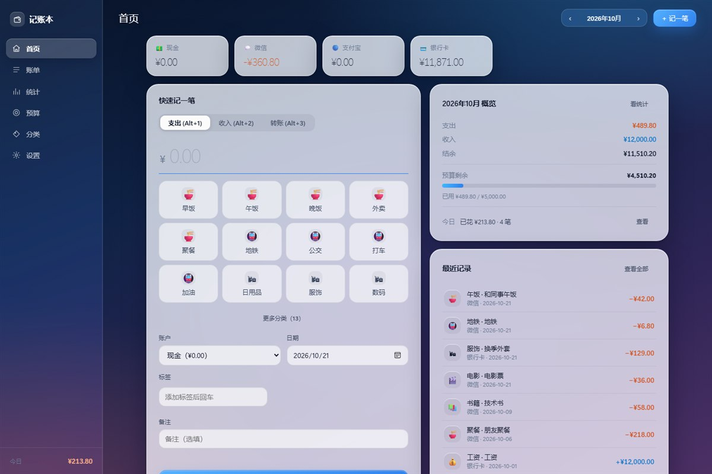
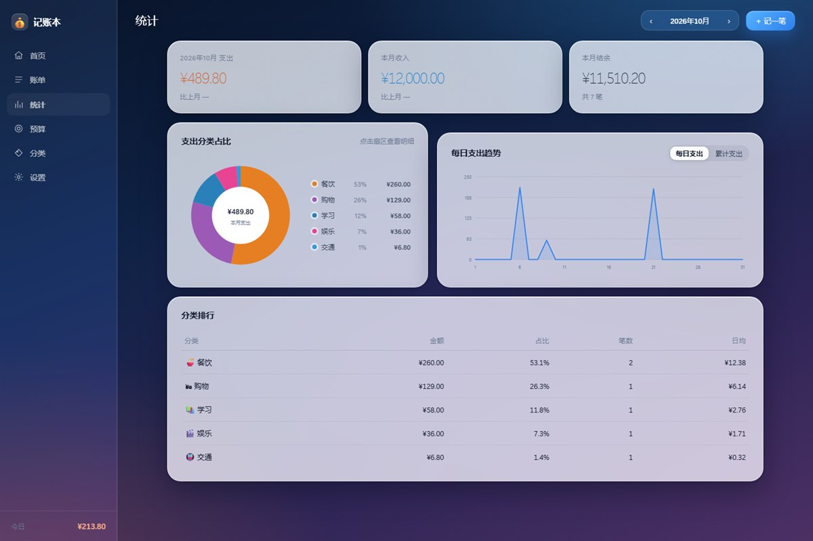
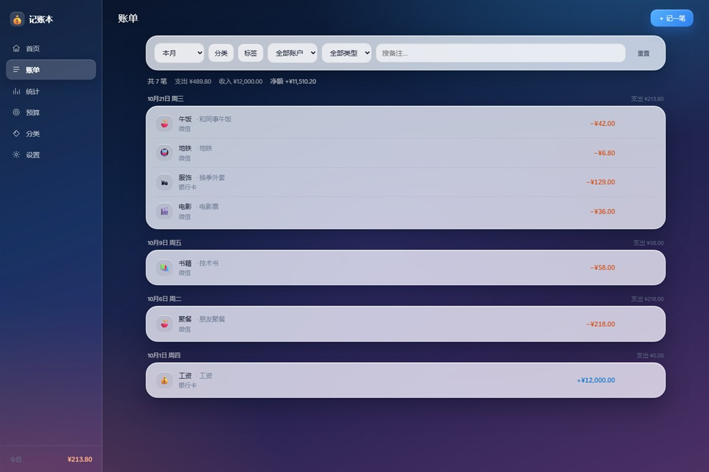
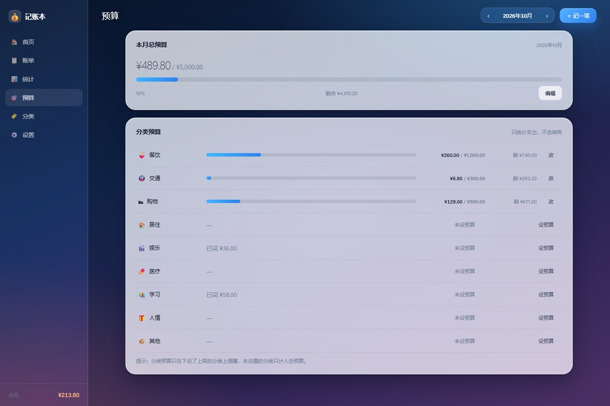

# 记账本

一个只在本机浏览器里运行的个人记账工具。不需要联网、不需要注册、不依赖任何云服务，数据存在你自己的电脑上。

## 界面风格

macOS 天气 App 风格的磨砂玻璃界面：深海蓝到暮紫的渐变背景、24px 大圆角的半透明卡片、背景模糊、细颗粒噪点、轻量大号数字与细线图标。日落橙表示支出，天空蓝表示收入。









>
> 以上截图由无头浏览器渲染实际页面得到，演示数据放在临时目录，未写入 `data/`。
## 怎么用

双击 **`记账本.exe`**。

- 会弹出一个小窗口，显示「服务运行中」和地址，浏览器自动打开记账页面。
- 窗口里可以点「打开记账页面」，或直接关窗口停止服务。
- 关闭窗口后数据不会丢，下次双击继续用。

> 第一次启动会在 exe 同目录生成 `data/`，里面是默认数据（4 个账户、9 个支出分类、5 个收入分类）。
> 数据全部保存在 `data/ledger.json`，把 exe 和 data 文件夹一起拷走就等于搬家。

**不需要安装任何东西**：exe 里已经内置了本地服务和全部页面，不依赖浏览器插件、Node、Python 或联网。

### 另一种启动方式（开发用）

如果改了 `app/` 里的页面文件想立刻生效，可以双击 `启动记账.bat`（走 PowerShell 服务，读同一份 `data/`）。
改完前端代码后重新编译 exe：`powershell -File tools\build-exe.ps1`。

## 界面说明

| 页面 | 做什么 |
|---|---|
| **首页** | 上方各账户余额；左边直接记账（支出 / 收入 / 转账）；右边本月概览、预算剩余、今日花费和最近 8 笔；下方是**月度日历**，每天显示收支，点某天可看当天明细 |
| **账单** | 按日期分组列出所有账目，可按日期段、分类、标签、账户、类型筛选，也能搜备注；点任意一行即可编辑或删除 |
| **统计** | 按月看支出/收入/结余和环比；饼图看分类占比（点扇区可钻到二级分类）；折线看每日或累计支出；下方是分类排行 |
| **预算** | 设置本月总预算和每个一级分类的预算，进度条会按 80%、100% 变色，超支时首页和侧边栏也会提醒 |
| **分类** | 维护两级分类：改名、换图标颜色、**拖动排序**、停用；子分类可**拖到别的大类**下，或在编辑弹窗里改「所属一级分类」；已被账目使用的分类不能硬删，只能停用或把账目转移走 |
| **设置** | 导出/导入 JSON 备份、导出 CSV、管理账户和标签、默认账户与超支提醒开关、清空数据 |

### 快捷操作

- `Alt + 1 / 2 / 3`：在支出 / 收入 / 转账之间切换
- 金额框里按 `Enter`：直接保存
- `Esc`：关闭弹窗

## 数据与备份

| 文件 | 说明 |
|---|---|
| `data\ledger.json` | 全部数据（账户、分类、标签、账目、预算、偏好） |
| `data\backup\ledger-*.json` | 自动历史副本，最多保留 20 份；每次启动和每天首次写入前各存一份 |
| `data\meta.json` | 数据版本号，用于防止两个窗口同时写坏数据 |

**备份**：设置页 →「导出 JSON 备份」，会下载一个 `ledger-backup-日期.json`。
**恢复**：设置页 →「从备份导入」，选择那个文件。导入前会自动把当前数据再备份一份，导入会整体覆盖。
**给 Excel 看**：设置页 →「导出 CSV」，可选本月 / 上月 / 全部，中文不会乱码。

如果 `ledger.json` 被意外改坏，下次启动会自动从最近的备份恢复，并在窗口里提示。

## 常见问题

**双击后浏览器没反应？**
看黑色窗口里是否有「记账服务已启动」。如果没有，多半是端口被别的程序占了——服务会自动尝试 8611–8620，窗口里会显示实际地址。

**浏览器显示「无法访问此页面」？**
说明服务窗口被关掉了。重新双击 `启动记账.bat` 即可。

**页面提示「本地服务未连接」？**
同上，服务没起来或中途被关闭。点「重试」或重新启动。

**数据会丢吗？**
正常开关浏览器不会。风险来自手动删除 `data` 目录或磁盘故障，所以建议每月导出一次 JSON 备份放到别处。

**能换电脑吗？**
把整个文件夹拷贝过去，双击启动即可；或者在新电脑上导入之前导出的 JSON。

## 目录结构

```
卢金汶的app\
├── 记账本.exe            # 单文件应用（内置服务与页面）
├── 启动记账.bat          # 备用入口（走 PowerShell 服务，便于改前端）
├── src\App.cs            # exe 的源码（C#）
├── app\                  # 前端页面（HTML / CSS / 原生 ES Module）
│   ├── index.html
│   ├── css\              # base / layout / components
│   ├── js\               # api / store / utils / selectors / charts / 各页面
│   └── tests\            # 浏览器内运行的单元与流程测试
├── server\server.ps1     # 本地 HTTP 服务 + 数据读写（PowerShell，零依赖）
├── data\                 # 运行后生成：数据与备份
├── tests\                # PowerShell 测试：接口、启动脚本、界面、总验收
├── tools\                # 冒烟测试、压测数据生成
├── docs\                 # 设计说明、验收记录
├── PRD.md                # 产品需求
└── DEV_PLAN.md           # 开发计划
```

## 开发与测试

不需要安装 Node、Python 或任何依赖，全部用 Windows 自带能力。

```powershell
# 全部验收（接口 + 启动脚本 + 冒烟 + 界面流程 + 静态检查）
powershell -ExecutionPolicy Bypass -File tests\accept.ps1

# 额外把 exe 当服务端跑一遍接口与界面测试（验证 exe 与脚本版行为一致）
powershell -ExecutionPolicy Bypass -File tests\accept.ps1 -WithExe

# 重新编译 exe
powershell -ExecutionPolicy Bypass -File tools\build-exe.ps1

# 只跑某一类
powershell -ExecutionPolicy Bypass -File tests\api.tests.ps1
powershell -ExecutionPolicy Bypass -File tests\ui.tests.ps1
```

界面测试用 Edge 无头模式加载 `app\tests\*.html`，真实点击按钮、填表单、验证 DOM 与数据落盘。

## 第一版不包含

云同步、登录、多设备、手机端、多账本、多币种、账单文件导入、年度报表、深色模式。完整清单见 `PRD.md` 第 9 节。
